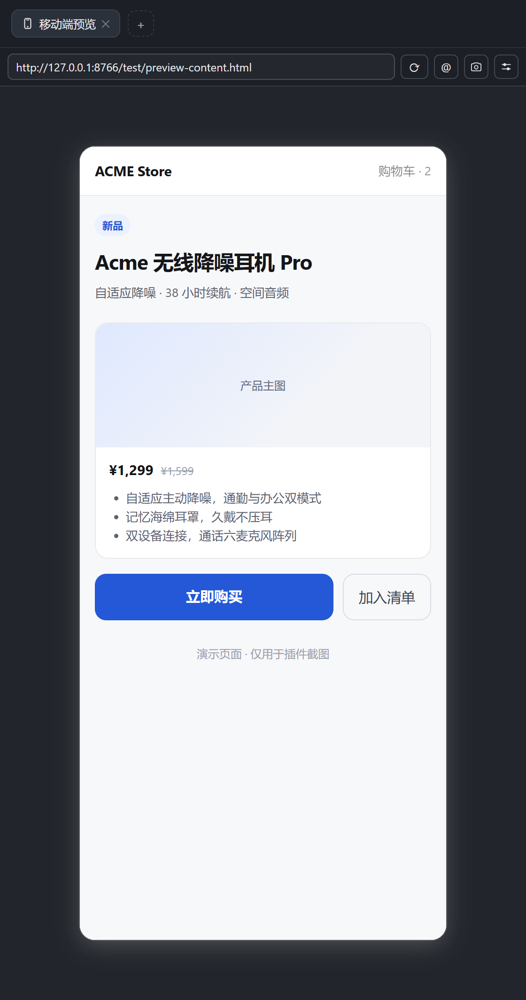
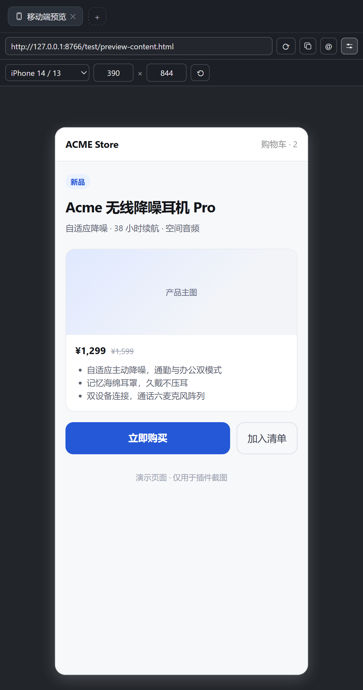
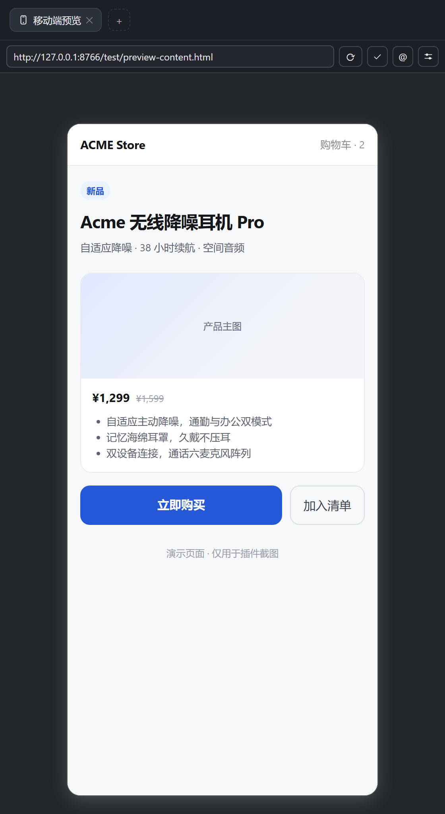
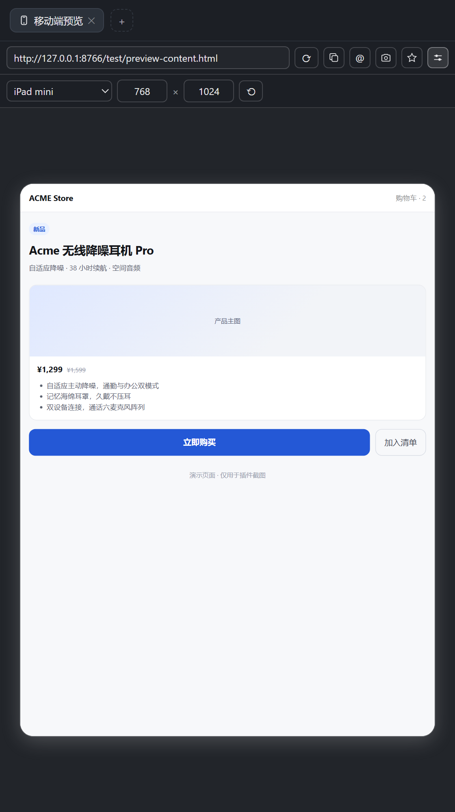

# dsh-sidebar-mobile-browser

给 **DeepSeek Harness（DSH）** 右侧边栏加一个「移动端预览」标签页：按手机 / 平板尺寸打开网页，
在对话框里用 `@` 或 `/url` 引用当前页面地址，一键复制 URL。

A mobile-device preview browser for the DSH right sidebar — device-sized frames, `@`-mention or `/url`
insertion of the current page URL from the composer, one-click copy.

- 标签页类型：**移动端预览**（与内置 Browser 并列，不替换它）
- 设备尺寸：9 个常见预设 + 自定义宽高（180–2560），最近一次尺寸会记住
- 尺寸栏**默认收起**，点工具栏最右的滑块图标展开 / 收起，地址栏与预览区因此始终占满高度
- 页面超出可用高度时**等比缩放**，不改网页视口宽高（看到的视口就是选定的设备宽度）
- **桌面端用 Electron guest webview 承载**：地址栏随站内跳转实时更新、按设备档位模拟 UA、
  截图直接 `capturePage()`；Web GUI 自动退回 iframe（其余功能不变）
- `@` 候选：本会话预览过的页面，最近一个标「当前页面地址」，选中即插入纯文本 URL
- `/url` 快捷指令：选中即把当前页面地址写进输入框（不用开 `@` 菜单、不用鼠标）
- 工具栏 `@` 按钮：同一件事的一键版，插到光标处，原有草稿不动
- 工具栏 `⭐` 按钮：把当前页设为**默认主页**（`localStorage`），之后新开的空白标签页自动打开它；再点一次取消
- 工具栏房屋按钮：**回到默认主页** —— 跨域页面里的站内跳转读不回地址栏，这是"走远了再回去"的可靠路径
- 工具栏相机按钮：**截图当前页** —— 抓的是设备框里的真实像素（复制到剪贴板，失败则下载 PNG）
- 工具栏：回车即打开、`⟳` 重载、复制图标（成功后短暂变对勾）、滑块图标切换尺寸栏
- 多标签页；切换标签不重载页面（`keepMounted`）；重启 DSH 后能恢复上次打开的页面

## 安装

**从市场安装（推荐）**：在 DSH 的插件市场搜索 `dsh-sidebar-mobile-browser` 后一键安装。

**从本仓目录安装**：把仓库目录当作 bundle 安装到当前 profile（DSH 插件管理器 / 插件市场工具的
“安装 bundle”入口，目标填本仓的绝对路径），装完按提示重载页面。

安装后右侧边栏「+」列表里会出现 **移动端预览**（手机图标）。

## 使用

1. 「+」→ **移动端预览**，或直接点这个标签页类型。
2. 地址栏输入 `example.com` 或完整 URL，**回车**打开（无单独“打开”按钮）。
3. 点工具栏最右的**滑块图标**展开尺寸栏：选预设，或选「自定义」直接改宽高数字（回车 / 失焦生效）；
   再点一次收起。默认收起，所以每次新开标签页都从「只有地址栏」的紧凑状态开始。
4. 工具栏：`⟳` 重载、复制图标复制当前 URL、`@` 把当前 URL 插入对话框、相机图标截图、
   房屋图标回到默认主页、`⭐` 设为默认主页、滑块图标切换尺寸栏；尺寸栏展开时右侧还有 `⟲` 横竖屏互换。
   桌面端（页面跑在 guest webview 上）时**地址栏随页面跳转实时更新**。
5. 点 `⭐` 之后，新开的空白标签页会直接打开这个默认主页；空状态里也有「打开默认主页」按钮。
   走远了点**房屋图标**即回默认主页；再点一次 `⭐` 取消默认主页。
   （Web GUI 里没有 webview 通道，地址栏只能停留在进入时的地址，这时房屋按钮就是唯一的“回去”入口。）
6. 点相机图标截图：桌面端直接 `capturePage()` 截设备框（无需选择器、逐像素准确），
   Web GUI 则弹出捕获选择器、选 **「当前标签页」** 后按设备框裁剪；结果先复制到剪贴板，
   剪贴板不支持图片时改为下载 `mobile-preview-<host>-<时间戳>.png`。
7. 每个会话记住最近 5 个预览页，用 `@` 可以回到其中任一页。
8. 对话框输入 `@` → 选「当前页面地址」即可把 URL 作为纯文本插入；
   或输入 `/url` 回车 —— 当前页面地址直接写进输入框，草稿里已有的内容会保留。
   两者都只在**该会话已经打开过预览页**时出现。

## 截图

| 默认：尺寸栏收起 | 尺寸栏展开：预设 + 宽高 + 横竖屏 |
| --- | --- |
|  |  |

| 复制成功（图标短暂变对勾） | 换成 iPad mini（768 × 1024） |
| --- | --- |
|  |  |

截图不是手绘原型：`test/preview.html` 载入**真实的 `client.js`** 在仿侧边栏的外壳里渲染，
再由无头 Chrome 截图（生成方法见「开发」）。同一份清单也放在仓库根的 `screenshots.json`，供插件市场读取。

## 兼容性

- 需要 DSH `0.2.x`（在 `0.2.1-rc.2` 上验证），Web 与 Desktop 两种 profile 都可用。
- 只用到公开扩展点：`ctx.sidebarRightTabs` / `ctx.slots` / `ctx.inputTriggers` / `ctx.commandUi` /
  `ctx.sessions` / `ctx.locale`，不 patch 任何内置模块。
- **桌面端**另外用外壳暴露的 `window.dshDesktop.browser`（`acquire` / `release`，与内置 Browser 标签同一通道）
  申请 guest webview；拿不到通道（Web GUI、或 acquire 被拒）时**自动退回 iframe**，功能不受影响、只是地址栏不跟随。
- 插入文本走对话面板公开的 action face（`captureInsertion` + `insertText`），不依赖内部事件。

## 已知局限

- **Web GUI 只能走 iframe**：地址栏停留在进入时的地址（同源策略读不到跳转），
  且目标站点返回 `X-Frame-Options` / CSP `frame-ancestors` 时会白屏 —— 这种页面用内置 Browser 标签打开。
- 桌面端的 guest 分区由主进程创建，按工作区分片（`dsh-sidebar-browser-*`），登录态与内置 Browser 标签**不共享**。
- guest 若 5 秒内没挂上 / 没开始导航，会自动退回 iframe（面板不会一直空着）；加载失败会显示错误码。
- UA 按尺寸档位模拟（手机 / 平板 / 桌面三档，改档会重载一次）；不做逐机型的完整指纹模拟。
- 桌面端嵌入的原生 Browser 标签页不参与尺寸模拟（本插件只作用于自己注册的标签页类型）。
- Web GUI 的截图仍走**屏幕捕获**（`getDisplayMedia`）再按设备框裁剪，每次都要在系统选择器里选「当前标签页」；
  环境拒绝该能力时会提示改用系统截图（Win+Shift+S）。
- DSH 以 HTTPS 提供服务时，`http://` 页面会被浏览器按混合内容拦截。

## 工作原理

| 扩展点 | 用途 |
| --- | --- |
| `ctx.sidebarRightTabs.register()` | 注册标签页类型 `id = sidebar-mobile-browser`、`kind = mobile-browser` |
| `ctx.slots.register({ name: 'sidebar.right.pane.tab', key })` | 渲染标签页主体（尺寸栏 + 页面载体 + 工具栏） |
| `ctx.slots.register({ name: 'sidebar.right.pane.tab.title', key })` | 标签页标题跟随当前地址的 host |
| `ctx.inputTriggers.registerSource({ trigger: '@', name: 'webpage' })` | 对话框 `@` 候选（按会话记录预览过的 URL） |
| `ctx.commandUi.register({ name: 'url', ui: { kind: 'action' } })` | `/url` 快捷指令，把当前页面地址写进输入框 |
| `ctx.sessions.scope(id)` → `conversation.input.shell(id).actions` | 插入文本用的公开 action face（先 `captureInsertion()` 取光标 span，再 `insertText()`） |
| `window.dshDesktop.browser.acquire()` / `release()` | 桌面端申请 guest webview（与内置 Browser 同一通道），拿不到就用 iframe |
| `will-attach-webview` 的放行条件 | 元素挂进 DOM 那一刻必须已带 `name=<lease>`、`partition=<批准的>`、`src=about:blank#<lease>`；顺序或时机不对会被 `preventDefault`（就是「一片空白」的成因），所以元素在 ref 回调里手工创建 |
| `ctx.locale.register()` | 中英文案内置 |

`index.js` 只是空的 Host 半边（bundle 行需要它）；全部能力在 `client.js`。

## 开发

```bash
npm run checks   # node --check index.js && node --check client.js
npm test         # 无 DSH 环境下的冒烟测试：shim 掉 React/window，验证标签页类型、两个 slot、@ 源与 onPick、/url 指令与插入路径
```

- 无构建步骤、无第三方依赖：纯 ESM（Host 半边）+ 浏览器 classic script（`client.js`）。

- `client.js` 是浏览器端 classic script，`window.__ModuleLoader__.load({ id, factory })` 导出 `{ inject, apply }`；
  直接 `require('react')` 即可，不依赖 DSH 内部客户端包（只通过 `inject` 声明顺序）。
- **改完 `client.js` 不会热替换已加载的模块**：Desktop 需要退出并重新打开应用（正式版没有“重新加载页面”菜单项），
  Web 端刷新页面即可。改了 `package.json` / `cordis.patch.yml` 需要重新安装 bundle。
- 版本：语义化版本，破坏性改动用 minor。

### 重新生成截图

`test/preview.html` 是一个仿右侧边栏的外壳：它注入一个极小的 React 兼容层与假的 DSH 上下文，
加载本仓的 `client.js` 并把标签页正文挂上去，因此截到的是**真正会跑的那份代码与样式**。
`test/preview-content.html` 是截图里被预览的示例页面。

```bash
# 1) 在仓库根起一个静态服务器（iframe 需要 http，file:// 会被插件的地址校验挡住）
python -m http.server 8766 --bind 127.0.0.1

# 2) 逐张开截图（Chrome 路径按本机调整）
CHROME="/c/Program Files/Google/Chrome/Application/chrome.exe"
BASE="http://127.0.0.1:8766/test/preview.html"
PAGE="http%3A%2F%2F127.0.0.1%3A8766%2Ftest%2Fpreview-content.html"
"$CHROME" --headless=new --hide-scrollbars --force-device-scale-factor=2 --window-size=560,1064 \
  --virtual-time-budget=9000 --screenshot=assets/screenshots/01-default.png "$BASE?url=$PAGE"
"$CHROME" --headless=new --hide-scrollbars --force-device-scale-factor=2 --window-size=560,1104 \
  --virtual-time-budget=9000 --screenshot=assets/screenshots/02-size.png "$BASE?open=1&url=$PAGE"
"$CHROME" --headless=new --hide-scrollbars --force-device-scale-factor=2 --window-size=560,1064 \
  --virtual-time-budget=9000 --screenshot=assets/screenshots/03-copied.png "$BASE?copy=1&url=$PAGE"
"$CHROME" --headless=new --hide-scrollbars --force-device-scale-factor=2 --window-size=560,1000 \
  --virtual-time-budget=9000 --screenshot=assets/screenshots/04-ipad.png "$BASE?size=ipad-mini&open=1&url=$PAGE"
```

URL 参数：`url` 要预览的页面、`size` 挂载前写进 `localStorage` 的预设 id、`open=1` 展开尺寸栏、
`copy=1` 点一次复制并冻结提示定时器（为了让「已复制」的对勾停在画面里）。

## 发布

1. `npm publish --access public`（`package.json` 已含 `files` / `exports` / `dsh.bundle` / `dsh.client`）。
2. 在 DSH 插件市场提交仓库与包名，审核后即可被搜索安装。
3. `repository` / `homepage` / `bugs` 已指向 `limingyao-xx/dsh-sidebar-mobile-browser`；改仓库名或换账号时记得同步。

## License

MIT — 可自由使用、修改、分发（含闭源分发），唯一条件是**在副本或实质性部分中保留版权声明与许可声明**，即 `LICENSE` 中的 `Copyright (c) 2026 10301139@qq.com`。

MIT 不要求标注“哪些地方被改过”。若希望派生版本**显式声明改动**并获得专利授权，可换成 Apache-2.0（需附 `NOTICE`，并按 §4(b) 在修改过的文件上注明变更）。

## 作者

10301139@qq.com — 问题、需求与 PR 都欢迎。
